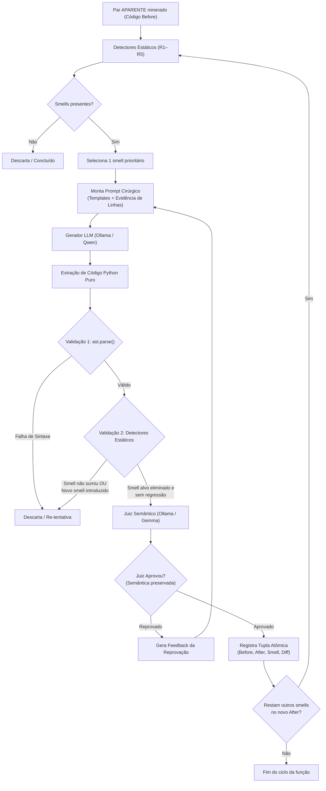

# Proposta Técnica: Pipeline de Refatoração Atômica com LLM (Tier C)

**Projeto:** PySniff — Detecção e Refatoração de Code Smells em Python (TP Engenharia de Software II — UFMG)  
**Data:** 09/11/2026  
**Status:** Aprovado para implementação  
**Referência de Tarefas:** [`tasks.md`](../tasks.md)

---

## 1. Contexto e Motivação

Durante a etapa de mineração de repositórios do GitHub (PyDriller e buscas por palavras-chave), constatou-se que a grande maioria dos commits humanos de refatoração são **ruidosos, poluídos e multi-objetivo** (frequentemente misturam correções com novas funcionalidades, alterações de regras de negócio, adições de parâmetros e refatorações parciais). Esses casos foram catalogados no projeto como **pares `APARENTE`**: códigos cujo *before* possui um smell real confirmado, mas cujo *after* não representa uma refatoração pura e cirúrgica.

O **Tier C (Fixed Synthetic)** surge para aproveitar a riqueza semântica do código real do *before* desses commits, utilizando modelos de linguagem (LLMs) instruídos formalmente para realizar refatorações estritamente atômicas, eliminando o smell detectado sem alterar o comportamento observável.

---

## 2. Princípios de Design e Diretrizes Metodológicas

### 2.1. Refatoração Atômica Sequencial (Um Smell por Vez)
Em vez de tentar resolver múltiplos smells em uma única chamada ao modelo, adota-se o princípio da **refatoração em cadeia (atômica)**:

1. **Pureza Causal:** Cada par gerado `(before, after)` deve isolar estritamente **uma única refatoração** referente a um único `smell_type`. Isso impede a contaminação dos dados que alimentarão o fine-tuning das LoRAs específicas (Trilha B).
2. **Multiplicador de Pares Legítimo:** Uma função complexa contendo múltiplos smells gera múltiplos pares limpos de treino em cascata:
   $$\text{Código } S_0 \xrightarrow{\text{elimina R3}} \text{Código } S_1 \implies \mathbf{\text{Par R3: } (S_0, S_1)}$$
   $$\text{Código } S_1 \xrightarrow{\text{elimina R4}} \text{Código } S_2 \implies \mathbf{\text{Par R4: } (S_1, S_2)}$$
3. **Minimização de Alucinação:** LLMs apresentam fidelidade semântica exponencialmente maior quando recebem diretrizes cirúrgicas ("substitua os literais apontados nas linhas X e Y por constantes em ALL_CAPS") do que quando instruídos a reescrever múltiplos aspectos de uma função longa.

### 2.2. Localização Fina por Evidência AST
Os detectores estáticos (`detectores/`) não devem atuar como caixas pretas que retornam apenas um booleano. O dicionário `evidence` de cada detector é enriquecido para retornar as **linhas exatas e nós da AST** causadores da violação:
* **R1 (Long Method):** Linhas de início/fim, métricas de statements e CCN.
* **R2 (Long Parameter List):** Lista exata dos parâmetros violadores.
* **R3 (Magic Numbers):** Valores e números das linhas dos literais não isentos.
* **R4 (Deep Nesting):** Linhas e blocos condicionais que excedem o limiar de profundidade.
* **R5 (Dead Code):** Linhas do código inalcançável e variáveis não utilizadas.

Essas informações são injetadas diretamente no prompt para que a LLM saiba com precisão cirúrgica onde deve intervir.

### 2.3. Anti-Circularidade Científica
Seguindo o rigor metodológico documentado em `DECISOES_PROJETO.md`:
* **Gerador ≠ Juiz ≠ Alvo de Treino** (famílias obrigatoriamente distintas).
* **Gerador (Tier C):** Família Qwen (ex.: `qwen2.5-coder:7b` ou `qwen2.5-coder:32b`).
* **Juiz Semântico:** Família Gemma (ex.: `gemma2:9b` ou `gemma2:27b`).
* **Alvo do Fine-Tuning futuro:** Família Stability AI (`Stable Code Instruct 3B`).

---

## 3. Fluxo de Execução do Pipeline



---

## 4. Camadas de Validação Híbrida

Para garantir qualidade sem desperdício de tempo de computação, a validação é executada em três barreiras de complexidade crescente:

1. **Barreira 1 — Validação Sintática (`ast.parse`):**
   * Execução instantânea (milissegundos).
   * Elimina qualquer resposta truncada, erros de indentação ou alucinações de sintaxe.
2. **Barreira 2 — Validação Estática Determinística (`detectores/`):**
   * Confirma que o smell alvo reporta `detected=False` no código refatorado.
   * Roda os outros 4 detectores para verificar **ausência de regressão** (ex.: a remoção de aninhamento não pode introduzir um método com complexidade ciclomática acima do limite).
3. **Barreira 3 — Julgamento Semântico e Comportamental (Juiz Gemma):**
   * Recebe o código antes e depois completo.
   * Avalia preservação de assinatura pública, contratos, tipos de retorno e lógica de negócio.
   * Se rejeitar, produz justificativa textual estruturada (ex.: *"O modelo removeu o tratamento de exceção na linha 15"*).

### Ciclo de Feedback e Re-tentativa
Se a Barreira 3 reprovar o código, o pipeline reexecuta a geração enviando ao modelo o histórico da tentativa anterior + o feedback explícito do juiz, permitindo até **2 re-tentativas**. Persistindo a reprovação, o par é descartado com log explicativo.

---

## 5. Estrutura de Armazenamento das Tuplas Geradas

Cada refatoração atômica aprovada é gravada em arquivo estruturado (JSONL), garantindo rastreabilidade completa:

```json
{
  "id": "tier_c_order_processing_r4_001",
  "smell_type": "R4",
  "repo": "owner/repo_minerado",
  "original_commit_hash": "a1b2c3d4...",
  "function_name": "process_items",
  "before_code": "def process_items(...):\n ...",
  "after_code": "def process_items(...):\n ...",
  "diff": "--- before\n+++ after\n@@ ... @@",
  "evidence_before": {
    "max_depth": 5,
    "violating_lines": [12, 14, 18]
  },
  "evidence_after": {
    "max_depth": 2,
    "violating_lines": []
  },
  "generator_model": "qwen2.5-coder:7b",
  "judge_model": "gemma2:9b",
  "judge_verdict": "APROVADO",
  "retries_needed": 0,
  "timestamp": "2026-11-09T10:30:00Z"
}
```

---

## 6. Mapeamento de Implementação

As tarefas técnicas necessárias para materializar este pipeline estão detalhadas em [`tasks.md`](../tasks.md):

* **T1:** Enriquecimento dos detectores com linhas e nós de evidência (`detectores/`).
* **T2:** Cliente de inferência HTTP para Ollama com extração de código (`extracao/llm/`).
* **T3:** Construtor de prompts cirúrgicos baseados em evidência (`extracao/refatoracao/`).
* **T4:** Módulo validador híbrido (AST + Juiz com feedback) (`extracao/refatoracao/`).
* **T5:** Runner CLI da esteira sequencial (`scripts/generate_tier_c.py`).
